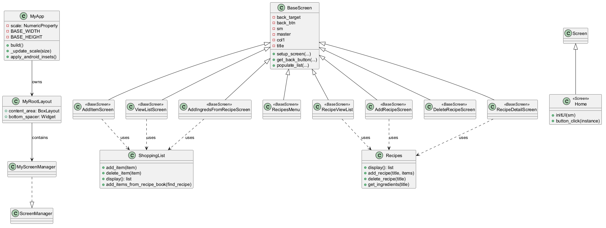

<p align="center">
  
</p>

# Groceries List

## Table of Contents
- [Description](#description)
- [Feature Overview](#feature-overview)
- [Build Directions](#build-directions)
- [Architecture](#architecture)

## Description
*Disclaimer; sarcasm and exhaustion are included in documentation by default*

Totally unique, totally original, totally new idea for; a shopping list app.

The thing that was important to me?  I wanted local copies, of *MY* recipes, no ads
and no connecting to other things.  Just use the recipes I keep cooking anyways, and 
put together my shopping list from those recipes.

I'm lazy.  If I can click a couple buttons, and drag myself to the store without having
to swap between my recipe and the shopping list, then organize the list, I will apparently
spend hours creating an app to have that time back.  So, here it is.  A simple, totally
original, totally new idea; a shopping list app.

## Feature Overview

- Read list
- Basic add/delete items to list
- Auto organization of list
- Add all items from a stored recipe
- Propose a random recipe
- Read recipes titles, read individual recipes stored ingredients list

## Build Directions
### Dependencies
*Note: buildozer has it's own list of dependencies I will not document here*
- python3.11 and python3.14
- Android SDK platform-tools
- kivy
- buildozer
- PlantUML (Documentation, the uml architecture image)

### Build directions
A couple notes -- to package the app I used buildozer.  Buildozer only works in a linux 
environment, and has it's own list of dependencies.  Developing in a windows environment, it
was easy to get around this using WSL.  This is only for the packaging portion anyways.

Build the app:
```
python3.11 -m buildozer android clean
python3.11 -m buildozer android debug
```

Connect your device, make sure it's in developer mode and your system can see it.  Then you
can just use adb to install the generated package from the previous step.
```
adb.exe install -r bin/*.apk
```

## Architecture
